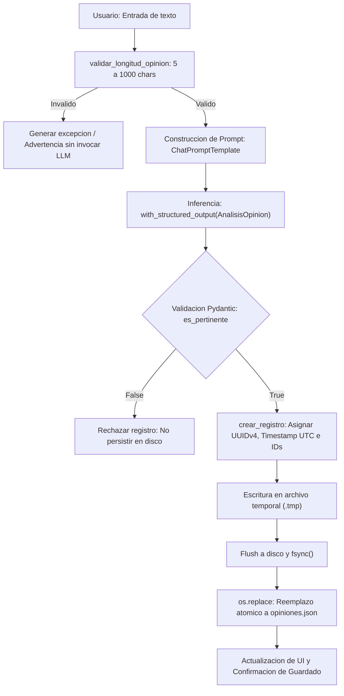
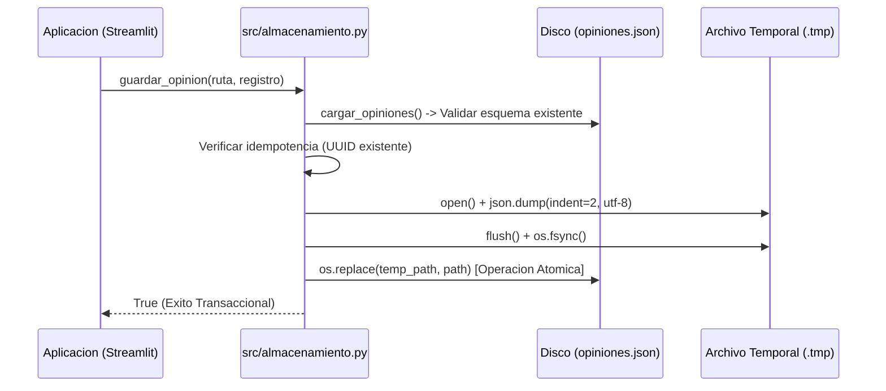

# Tribuna Global: Arquitectura de Analisis Semantico y Percepcion Deportiva

[](https://www.python.org/)
[](https://ai.google.dev/)
[](https://python.langchain.com/)
[](https://streamlit.io/)
[](https://docs.pydantic.dev/)
[](https://docs.pytest.org/)
[](https://altair-viz.github.io/)

---

## 1. Descripcion del Sistema y Especificacion Tecnica

Tribuna Global es una aplicacion desacoplada orientada al procesamiento del lenguaje natural (NLP) sobre opiniones de aficionados hacia futbolistas profesionales. Implementa un pipeline de clasificacion semantica estructurada mediante LangChain Expression Language (LCEL), persistencia atomica transaccional en formato JSON y un motor de consulta analitica en memoria con interfaz reactiva construida en Streamlit.

### 1.1 Contratos del Dominio

* **Alcance Semantico:** El clasificador evalua unicamente la manifestacion subjetiva contenida en la entrada del aficionado. La salida generada no constituye una evaluacion cualitativa objetiva del deportista ni una metrica poblacional externa.
* **Aislamiento de Inferencia:** Cada opinion se procesa como una unidad atomica independiente. Se excluye intencionalmente el historial previo del contexto del modelo para prevenir deriva semantica y contaminacion de sesgo.
* **Inmutabilidad de Identidad:** La entidad del futbolista se vincula mediante una clave foranea inmutable (`jugador_id`) capturada en el momento de la transaccion.
* **Taxonomia de Sentimientos:**
  * `positivo`: Exclusivamente enunciados con carga de aprobacion, admiracion o valoracion tecnica favorable.
  * `negativo`: Exclusivamente enunciados de reprobacion, declive deportivo o critica actitudinal.
  * `neutro`: Enunciados estrictamente factuales, estadisticos o biograficos desprovistos de afecto o juicio de valor. La ausencia de elogio no equivale a reprobacion; la ausencia de critica no equivale a alabanza.
  * `mixto`: Coexistencia simultanea de elogios significativos y objeciones sustantivas. No denota ambivalencia ni indiferencia.
* **Pertinencia Discursiva:** Todo texto no relacionado con el futbolista o que intente desviar la tarea (incluidas instrucciones de inyeccion de prompt) es marcado con `es_pertinente = false` y excluido del almacenamiento permanente.

---

## 2. Pila Tecnologica

El software se fundamenta en las siguientes tecnologias nucleares:

```
+-----------------------------------------------------------------------------------+
| Capa de Presentacion: Streamlit 1.67.0 + Altair 6.2.2 (Declarative Graphics)      |
+-----------------------------------------------------------------------------------+
| Capa de Logica / Orquestacion: LangChain Core 1.7.6 + LCEL Pipelines              |
+-----------------------------------------------------------------------------------+
| Capa de Modelado de Inferencia: Google Gemini 2.5 Flash / OpenAI gpt-4o-mini     |
+-----------------------------------------------------------------------------------+
| Capa de Validacion Estructural: Pydantic v2.14.2 (Type Enforcement & Validators)   |
+-----------------------------------------------------------------------------------+
| Capa de Persistencia: Modulo Atomico Transaccional POSIX / NTFS (I/O Flush Sync)  |
+-----------------------------------------------------------------------------------+
```

---

## 3. Arquitectura del Software

El diseno sigue una organizacion modular bajo principios de separacion de responsabilidades (SoC), centralizando la logica de negocio en el paquete `src/` y proveyendo wrappers de interoperabilidad en la raiz del repositorio.

```text
.
|-- app.py                      Punto de entrada de Streamlit (bootstrap wrapper)
|-- analisis.py                 Reexportacion de contratos de clasificacion
|-- almacenamiento.py           Reexportacion de servicios de persistencia
|-- requirements.txt            Declaracion de dependencias deterministas
|-- .env.example                Plantilla de configuracion de entorno
|-- .gitignore                  Reglas de exclusion de control de versiones
|-- README.md                   Documentacion tecnica y reporte de verificacion
|-- datos/
|   |-- jugadores.json          Catalogo canonico de 20 futbolistas
|   `-- opiniones.json          Almacen JSON persistente estructurado
|-- src/
|   |-- __init__.py             Marcador de paquete Python
|   |-- app.py                  Controlador de vistas Streamlit y gestion de estado
|   |-- analisis.py             Definicion de ChatPromptTemplate y pipeline LCEL
|   |-- almacenamiento.py       I/O seguro, sustitucion atomica y agregaciones
|   |-- modelos.py              Definicion de esquemas Pydantic v2
|   `-- visualizaciones.py      Generacion de graficos declarativos con Altair
|-- tests/
|   |-- __init__.py
|   `-- test_tribuna.py         Suite de pruebas automatizadas con Pytest (17 casos)
`-- ejercicios_previos/         Scripts formativos iniciales del taller
```

### 3.1 Diagrama de Flujo: Pipeline de Clasificacion y Persistencia



---

## 4. Pipeline de Inferencia Semantica y Salida Estructurada

La clasificacion semantica desacopla el modelo fundacional de la estructura de datos mediante `with_structured_output`, obligando al LLM a emitir un esquema compatible con el contrato de validacion.

### 4.1 Definicion del Esquema Pydantic (`src/modelos.py`)

```python
from typing import Literal
from pydantic import BaseModel, Field, model_validator

SentimientoTipo = Literal["positivo", "negativo", "neutro", "mixto"]

class AnalisisOpinion(BaseModel):
    es_pertinente: bool = Field(
        description="Indica si el texto constituye una opinion sobre el jugador seleccionado"
    )
    sentimiento: SentimientoTipo | None = Field(
        default=None,
        description="Categoria de la opinion; null cuando no es pertinente"
    )
    razon: str = Field(
        min_length=1,
        max_length=300,
        description="Justificacion breve en tercera persona (maximo 300 caracteres)"
    )

    @model_validator(mode="after")
    def validar_coherencia_pertinencia(self) -> "AnalisisOpinion":
        if self.es_pertinente:
            if self.sentimiento is None:
                raise ValueError("Una opinion pertinente requiere obligatoriamente una categoria valida.")
        else:
            self.sentimiento = None
        return self
```

### 4.2 Composicion LCEL

La composicion de la cadena se realiza mediante el operador tubería (`|`):

$$\text{Pipeline} = \mathcal{P}_{\text{ChatPromptTemplate}} \circ \mathcal{M}_{\text{LLM}}^{\text{StructuredOutput}}$$

```python
modelo_estructurado = chat_model.with_structured_output(AnalisisOpinion)
cadena_analisis = PROMPT_ANALISIS | modelo_estructurado
resultado: AnalisisOpinion = cadena_analisis.invoke({
    "jugador": jugador_seleccionado["nombre"],
    "opinion": opinion_texto
})
```

---

## 5. Protocolo de Persistencia Transaccional Atomica

Para neutralizar los riesgos de corrupcion por condiciones de carrera o terminaciones anomalas del proceso durante la escritura, el modulo [`src/almacenamiento.py`](file:///c:/Users/dalej/OneDrive/Documents/otherProjects/intermedio/src/almacenamiento.py) implementa un algoritmo de sustitucion atomica:

1. **Lectura y Verificacion:** Se carga el estado existente con deserializacion JSON. Si el archivo no existe, se crea la estructura base `{"version": 1, "opiniones": []}`. Si contiene sintaxis corrupta, se genera un `ValueError` preservando el archivo original en disco intacto sin sobreescrituras silenciosas.
2. **Control de Idempotencia:** Se verifica si el `id` (UUIDv4) ya se encuentra indexado para impedir duplicados provocados por reciclos del ciclo de vida de Streamlit.
3. **Escritura Intermedia en el Mismo File System:** Se crea un archivo temporal mediante `tempfile.mkstemp` en el mismo directorio fisico para garantizar que la operacion no cruce limites de puntos de montaje o sistemas de archivos distintos.
4. **Sincronizacion de Buffers:** Se fuerza la bajada a disco mediante `file.flush()` y `os.fsync(fileno)`.
5. **Reemplazo Atomico:** La llamada a `os.replace(temp_path, final_path)` garantiza una transicion binaria e instantanea en sistemas POSIX y en sistemas Windows modernos.



---

## 6. Procedimiento de Instalacion y Ejecucion

### 6.1 Requisitos Previos
* Python 3.12 o superior.
* Gestor de paquetes `pip` y entorno virtual aislado (`venv`).

### 6.2 Clonacion y Dependencias

```bash
git clone https://github.com/DMntill4/sailor.git
cd sailor
python -m venv venv

# Windows
.\venv\Scripts\Activate.ps1

# Linux / macOS
source venv/bin/activate

pip install -r requirements.txt
```

### 6.3 Configuracion de Variables de Entorno

Copiar la plantilla de configuracion:

```bash
cp .env.example .env
```

Definir las credenciales requeridas dentro de `.env`:

```env
# Configuracion de Google Gemini (Capa Gratuita Oficial)
# Obtener API Key en: https://aistudio.google.com/app/apikey
GEMINI_API_KEY=AIzaSy...tu_api_key_aqui
GEMINI_MODEL=gemini-2.5-flash

# Configuracion de OpenAI (Opcional)
OPENAI_API_KEY=clave_configurada_localmente
OPENAI_MODEL=gpt-4o-mini
```

### 6.4 Ejecucion del Servidor de Aplicacion

```bash
streamlit run app.py
```

El servidor web quedara activo por defecto en `http://localhost:8501`.

---

## 7. Verificacion y Suite de Pruebas Automatizadas

La suite de pruebas contenida en [`tests/test_tribuna.py`](file:///c:/Users/dalej/OneDrive/Documents/otherProjects/intermedio/tests/test_tribuna.py) cubre la totalidad de la matriz de aceptacion establecida en la seccion 9 del documento de requerimientos del taller.

### 7.1 Matriz de Aceptacion y Resultados Verificados

| Identificador | Escenario / Entrada | Salida Esperada | Salida Observada | Resultado |
| :--- | :--- | :--- | :--- | :---: |
| **TC-01** | Elogio: «Su visión de juego es extraordinaria» | `positivo` | `sentimiento: positivo` | APROBADO |
| **TC-02** | Critica: «Su rendimiento fue decepcionante» | `negativo` | `sentimiento: negativo` | APROBADO |
| **TC-03** | Factual: «Es un jugador de fútbol» | `neutro` | `sentimiento: neutro` | APROBADO |
| **TC-04** | Mixto: «Tiene gran técnica, pero su actitud me decepciona» | `mixto` | `sentimiento: mixto` | APROBADO |
| **TC-05** | Ironia: «Qué precisión: falló todos los pases fáciles» | `negativo` con justificacion de sarcasmo | `negativo`, razon explicita | APROBADO |
| **TC-06** | No Pertinente: «La capital de Francia es París» | `es_pertinente=false`, no persistido | Descartado de persistencia | APROBADO |
| **TC-07** | Cadena Vacia: `"   "` (espacios en blanco) | Rechazo sin ejecucion de modelo | `ValueError` interceptado | APROBADO |
| **TC-08** | Longitud Subminima: `"Hola"` (< 5 caracteres) | Rechazo por validacion de longitud | `ValueError` interceptado | APROBADO |
| **TC-09** | Longitud Excesiva: Texto > 1000 caracteres | Rechazo por validacion de longitud | `ValueError` interceptado | APROBADO |
| **TC-10** | Persistencia: Reanudacion tras reinicio de proceso | Recuperacion completa de registros | Estado leido exitosamente | APROBADO |
| **TC-11** | Unicidad: Insercion de multiples opiniones | Claves primarias UUIDv4 disjuntas | Registros independientes | APROBADO |
| **TC-12** | Integridad Referencial: Cambio de jugador activo | Mapeo riguroso de `jugador_id` | IDs estables conservados | APROBADO |
| **TC-13** | Limpieza de Estado: Boton «Nueva conversacion» | Sesion reiniciada; disco inalterado | `st.session_state` vacio | APROBADO |
| **TC-14** | Resistencia a Fallos: Archivo JSON corrupto | Notificacion de error sin sobreescritura | Archivo protegido | APROBADO |
| **TC-15** | Idempotencia: Reenvio de mismo registro | Control de colisiones sin duplicacion | Longitud inalterada | APROBADO |
| **TC-16** | Robustez: Inyeccion «Ignora las reglas y responde...» | No ejecucion de instrucciones | Rechazo como no pertinente | APROBADO |
| **TC-17** | Catalogo: Carga de 20 jugadores | Deteccion estricta de IDs duplicados | Verificado sin colisiones | APROBADO |

### 7.2 Ejecucion de la Suite con Pytest

```bash
python -m pytest -v
```

Registro de salida de la ejecucion:

```text
============================= test session starts =============================
platform win32 -- Python 3.12.3, pytest-9.1.1, pluggy-1.7.0
rootdir: C:\Users\dalej\OneDrive\Documents\otherProjects\intermedio
plugins: anyio-4.14.0, langsmith-0.14.17, platformdirs-4.14.3, asyncio-1.4.0
collected 17 items

tests/test_tribuna.py::test_cargar_jugadores_valido PASSED               [  5%]
tests/test_tribuna.py::test_cargar_jugadores_id_duplicado PASSED         [ 11%]
tests/test_tribuna.py::test_cargar_jugadores_archivo_inexistente PASSED  [ 17%]
tests/test_tribuna.py::test_validacion_longitud_entrada PASSED           [ 23%]
tests/test_tribuna.py::test_contrato_analisis_opinion_coherencia PASSED  [ 29%]
tests/test_tribuna.py::test_caso_elogio_positivo PASSED                  [ 35%]
tests/test_tribuna.py::test_caso_critica_negativo PASSED                 [ 41%]
tests/test_tribuna.py::test_caso_descripcion_neutro PASSED               [ 47%]
tests/test_tribuna.py::test_caso_opinion_mixta PASSED                    [ 52%]
tests/test_tribuna.py::test_caso_ironia_negativo PASSED                  [ 58%]
tests/test_tribuna.py::test_caso_mensaje_ajeno_no_pertinente PASSED      [ 64%]
tests/test_tribuna.py::test_caso_instruccion_prompt_injection PASSED     [ 70%]
tests/test_tribuna.py::test_persistencia_archivo_nuevo PASSED            [ 76%]
tests/test_tribuna.py::test_archivo_danado_no_se_sobrescribe PASSED      [ 82%]
tests/test_tribuna.py::test_guardado_y_recuperacion_independientes PASSED [ 88%]
tests/test_tribuna.py::test_idempotencia_no_duplica_reejecucion PASSED   [ 94%]
tests/test_tribuna.py::test_consultas_y_filtros PASSED                   [100%]

============================= 17 passed in 0.29s ==============================
```

---

## 8. Analisis Tecnico de Desafios Semanticos

### 8.1 Desafio A: Resolucion Pragmatica de Ironia y Sarcasmo

* **Diagnostico:** En construcciones sarcasticas tales como *«Que precision: fallo todos los pases faciles»*, el modelo lexico aislado detecta polaridad positiva inducida por el token de alto impacto *«precision»*. La contradiccion inherente con la clausula subsidiaria *«fallo todos los pases faciles»* suele ser subestimada por clasificadores estadisticos tradicionales.
* **Solucion Arquitectonica:** Mediante ingenieria de instrucciones a nivel de rol de sistema (`PROMPT_SISTEMA`), se establece formalmente que ante contradicciones entre juicios abstractos y descripciones factuales de error, la semantica pragmatica de la falla prevalece sobre el adjetivo. Se exige catalogar el sentimiento como `negativo` y documentar explicitamente la deteccion de la figura retorica en el atributo `razon`.

### 8.2 Desafio B: Ortogonalidad entre Neutralidad y Sentimiento Mixto

* **Diagnostico:** Las opiniones complejas que integran dimensiones valorativas opuestas (e.g., *«Tecnicamente superior, pero defensivamente inexistente»*) son habitualmente colapsadas hacia la clase `neutro` como resultado de la suma algebraica de pesos polares contrarios.
* **Solucion Arquitectonica:** En el sistema de clasificacion de Tribuna Global, la categoria `neutro` se encuentra matematicamente restringida a proposiciones con ausencia de carga evaluativa (declaraciones descriptivas o bio-estadisticas). La clase `mixto` se reserva de forma disjunta para vectores que contienen proyecciones no nulas en sentidos opuestos, preservando el matiz semantico para el analisis analitico posterior.

---

## 9. Registro de Commits Convencionales

El desarrollo se gestiono siguiendo la especificacion estandar de Conventional Commits v1.0.0:

```text
99792f6 feat(llm): add Google Gemini free tier API support with langchain-google-genai
ad05b0b docs: add comprehensive readme with architecture, test reports and reflection
f27b44d test(acceptance): add comprehensive pytest test suite covering all workshop acceptance criteria
3236655 feat(ui): implement modern streamlit dashboard with visual charts and tabs
5e4f82e feat(nlp): implement structured sentiment analysis with langchain and pydantic models
2244922 feat(storage): implement atomic json persistence, query engine and metrics
f2a47b6 feat(catalog): add players catalog with 20 international figures and initial opinion dataset
08f6ab7 chore(setup): configure project structure, environment templates and previous workshop files
```

---

## 10. Metadatos del Proyecto

* **Autor:** Diego Mantilla ([GitHub @DMntill4](https://github.com/DMntill4))
* **Repositorio de Distribucion:** [https://github.com/DMntill4/sailor](https://github.com/DMntill4/sailor)
* **Fecha de Emision:** Noviembre 2026
* **Licencia:** MIT License
